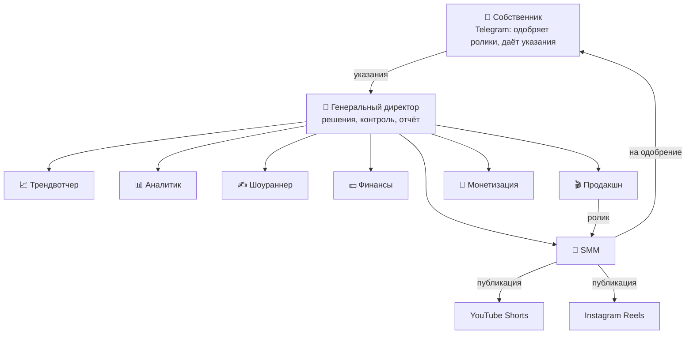

# AI Company

Компания из ИИ-агентов, которая сама придумывает, снимает и публикует короткие ролики
с ИИ-персонажем для англоязычной аудитории и ищет, как на них заработать.
Руководит ею Генеральный директор (Claude), собственник — ты.

**Офис в прямом эфире:** https://populity.github.io/AI-company/
Пиксельный офис, где видно, кто из сотрудников чем занят, ролики на конвейере, цифры и лента событий.

**Первый запуск:** [SETUP.md](SETUP.md) — пошагово, около часа.

## Как устроена компания



| Кто | Что делает |
|---|---|
| Директор | каждый день решает, что снимать, ставит задачи, проверяет работу, пишет тебе отчёт |
| Трендвотчер | ищет, что сейчас залетает в коротких видео |
| Аналитик | собирает просмотры и подписчиков, находит, что работает |
| Шоураннер | ведёт персонажа и сериал, пишет сценарии с репликами |
| Финансы | не даёт выйти за бюджет, считает расходы и доходы |
| Продакшн | генерирует кадры и видео со звуком, монтирует, ловит брак |
| SMM | названия, описания, хэштеги, отправка на одобрение и публикация |
| Монетизация | раз в неделю: пороги монетизации, партнёрки, бренды, свои продукты |

Инструкции каждого сотрудника — в `.claude/agents/`, устав компании — в [CLAUDE.md](CLAUDE.md).

## Рабочий день

Каждый день в 09:17 по Москве GitHub запускает директора (`.github/workflows/daily-cycle.yml`):

1. Аналитик и Трендвотчер приносят цифры и тренды.
2. Директор читает твои указания из Telegram и решает, какую серию снимаем.
3. Финансы утверждают смету, Шоураннер пишет сценарий, Продакшн делает ролик.
4. SMM готовит тексты и отправляет ролик тебе в Telegram с кнопками «Публикуем / Переделать».
5. Директор присылает отчёт.

Каждые 20 минут бот проверяет твои ответы: нажал «Публикуем» — ролик уходит на площадки.
Первые 14 дней каждый ролик проходит через тебя, потом включается автопилот
(вернуть ручной режим: `/auto off` в боте).

## Что делаешь ты

- Одобряешь или возвращаешь ролики кнопками в Telegram (ответ текстом на ролик — что исправить).
- Пишешь боту указания обычным текстом: «попробуйте серию про осень», «меньше шуток про работу».
- Делаешь то, что агентам нельзя: регистрации, оплаты, договоры, переписку с брендами.
  Директор пишет, что именно и где нажать.

Команды бота: `/status`, `/budget`, `/run` (начать рабочий день сейчас), `/pause`, `/resume`,
`/auto on|off`, `/revenue 25 brand заметка` (записать доход).

## Деньги

| Статья | Сколько |
|---|---|
| Генерация видео и картинок (fal.ai) | до 2 000 ₽ ≈ $22 в месяц — лимит в `config/company.json` |
| Claude | твоя подписка Pro, отдельно не платишь |
| GitHub, Telegram, YouTube/Instagram API | бесплатно |

Один ролик (кадр + 8–12 секунд видео со звуком) стоит примерно $0.5–0.7.
Бюджета хватает примерно на ролик в день.

## Честно о границах

- **Заработок не гарантирован.** Новому каналу нужны месяцы, чтобы дойти до порогов монетизации.
  Партнёрки и интеграции становятся реальными примерно от тысячи подписчиков.
- **YouTube** не даёт новым приложениям публиковать через API публично, пока проект не пройдёт
  проверку Google. До этого бот присылает тебе готовый ролик и текст, а ты выкладываешь
  его в приложении YouTube за минуту. Как подать на проверку — в SETUP.md.
- **Подписка Pro** имеет лимиты. Рабочий день расходует часть лимита. Если в это же время активно
  пользуешься Claude сам, можно упереться в лимит — тогда день доделается в следующий запуск.
- **Площадки не любят штампованный ИИ-контент.** Поэтому в уставе запрещены шаблонные серии,
  и ИИ-происхождение роликов честно помечается.

## Работать с директором напрямую

- **С телефона или из браузера:** открой [claude.ai/code](https://claude.ai/code), выбери репозиторий
  `AI-company` и пиши директору как в чате: «как дела?» (или `/status`), «сделай сегодня ещё одну серию».
- **На компьютере:** `git clone https://github.com/Populity/AI-company`, затем в папке репозитория
  команда `claude`. Ключи для запуска на компьютере — в файле `.env` (образец — `.env.example`).

## Карта репозитория

```
CLAUDE.md                 устав компании (читает директор)
.claude/agents/           сотрудники
.claude/commands/         рабочий день, день основания, еженедельный обзор, статус
config/company.json       твои настройки: бюджет, площадки, режим одобрения
config/models.json        модели генерации и цены
company/                  память компании: стратегия, герой, ролики, отчёты, решения, цифры
tools/                    инструменты агентов (Python)
docs/                     пиксельный офис (GitHub Pages)
.github/workflows/        расписание: рабочий день, ответы в Telegram, проверка настройки
```
